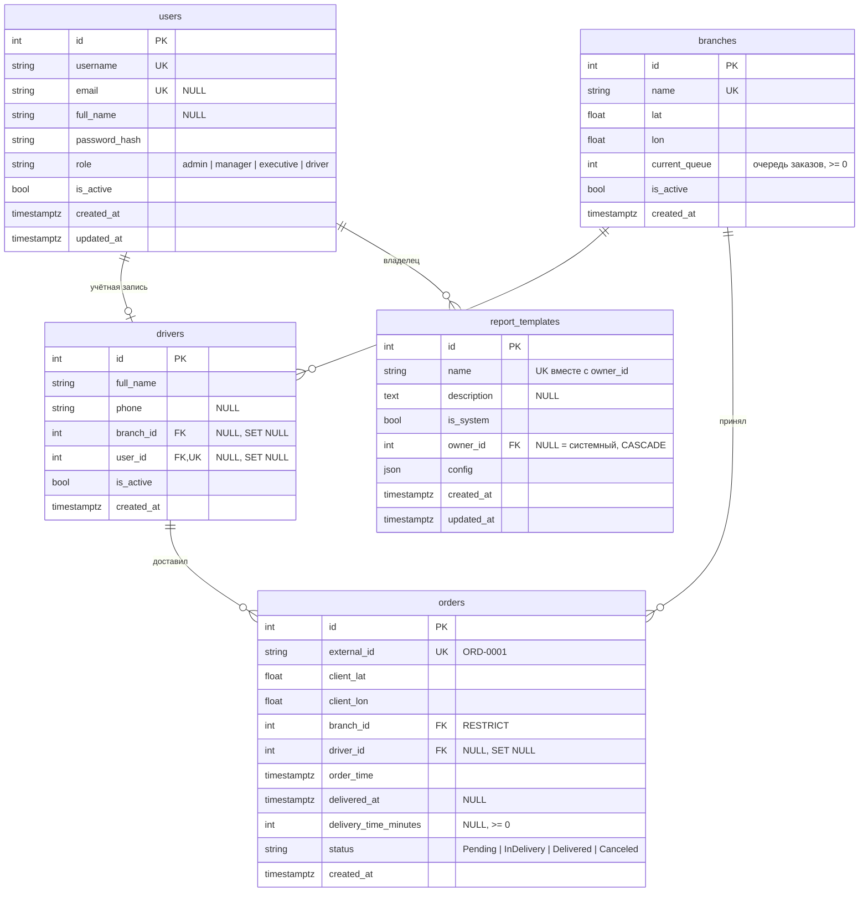

# Схема БД (ER-диаграмма)

СУБД — PostgreSQL 16 (в тестах — SQLite). Схема описана ORM-моделями
`backend/app/db/models/` и создаётся миграциями Alembic (`backend/alembic/versions/`).

## Ограничения и индексы

| Таблица | Ограничения | Индексы |
|---|---|---|
| `users` | `uq_users_username`, `uq_users_email`, `ck_users_role` | — |
| `branches` | `uq_branches_name`, `ck_branches_current_queue_non_negative` | — |
| `drivers` | `uq_drivers_user_id` | `ix_drivers_branch_id` |
| `orders` | `uq_orders_external_id`, `ck_orders_status`, `ck_orders_delivery_time_non_negative` | `ix_orders_order_time`, `ix_orders_branch_id_order_time`, `ix_orders_status`, `ix_orders_driver_id` |
| `report_templates` | `uq_report_templates_owner_id_name` | — |

Роли и статусы хранятся строками с `CHECK`-ограничением (а не нативным enum PostgreSQL),
`config` — переносимый `JSON`: так схема одинаково работает на PostgreSQL и SQLite.
Все даты — `timestamptz`, приложение работает с ними в UTC.
